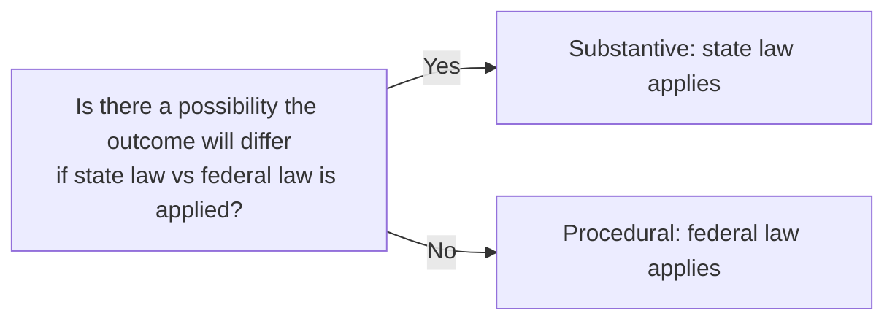

# Outcome Determinative Test

From [[Guaranty Trust Co. v. York]].

> Does it **significantly affect the result** of the litigation for the federal court to disregard the state law that would control the same claim in state court?

## Applying with Erie

Later **modified** by the [[Byrd Balancing Test]]: from a mere *possibility* of a different outcome to a *likelihood*.
