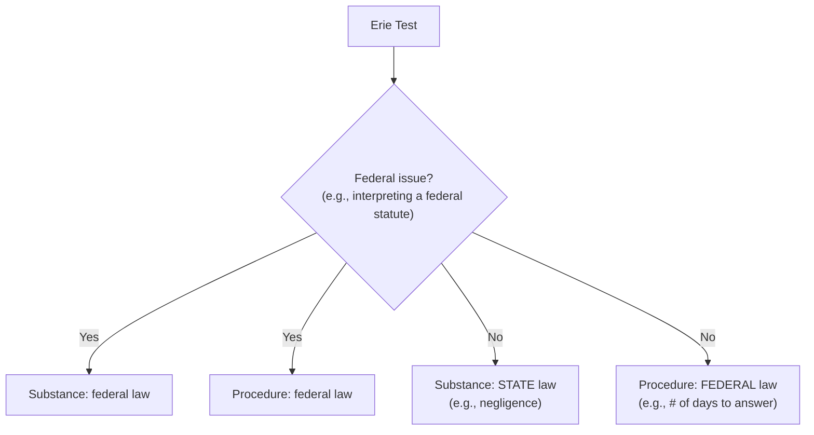
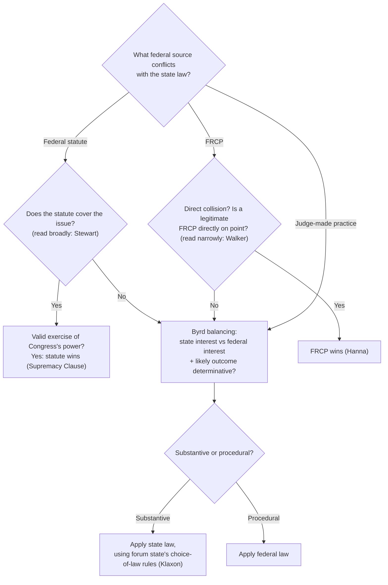

# Erie Analysis Framework

## The basic Erie test

## Full decision tree for a state-law claim in federal court

## Checklist
1. Is jurisdiction based on **FQ**? If so, apply federal law and stop.
2. **Diversity or supplemental** over a state claim? Identify the conflict.
3. Federal **statute** on point? See [[Stewart Organization v. Ricoh Corp.]] (broad reading, statute wins if valid).
4. **FRCP** on point with a direct collision? See [[Hanna v. Plumer]] and [[Walker v. Armco Steel Corp.]]
5. Otherwise use the [[Byrd Balancing Test]] (with the [[Outcome Determinative Test]] from [[Guaranty Trust Co. v. York]]).
6. If state law applies, **which state?** Use the forum state's conflict rules ([[Klaxon Co. v. Stentor Electric Manufacturing]]). After a §1404 transfer, use the transferor's law; after §1406, the transferee's ([[Transfer of Venue]]).
