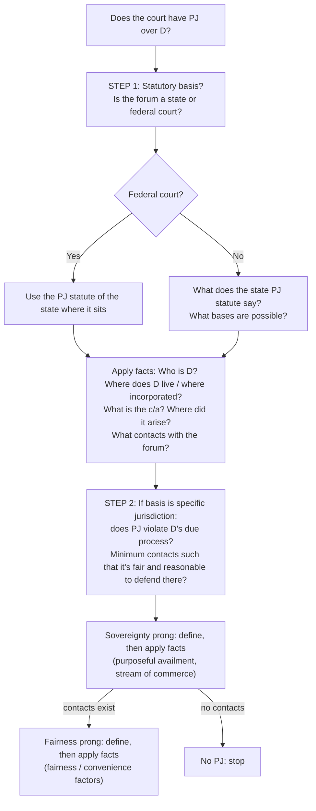

# PJ Analysis Framework

## Checklist
1. **Notice:** was D properly served? ([[Notice and Service of Process]])
2. **Basis:** do the facts fall within the state [[Long-Arm Statutes|long-arm statute]]?
   - [[General Jurisdiction]]: consent, presence + service ([[Transient Jurisdiction]]), residence/domicile, property, "at home" (systematic and continuous)
   - [[Specific Jurisdiction]]: isolated contact + claim arises from or relates to it
3. **Due process** ([[Due Process Clause]]):
   - **Sovereignty:** [[Minimum Contacts]]. Consider [[Purposeful Availment]], [[Stream of Commerce]], foreseeability ([[World-Wide Volkswagen Corp. v. Woodson]]), and website interactivity ([[Zippo Manufacturing Co. v. Zippo Dot Com]]).
   - **Fairness:** [[Fairness Factors]]
4. **Property-based?** Apply [[Shaffer v. Heitner]].
5. **Waiver:** lack of PJ is waived if not raised in the first Rule 12 response. See [[FRCP Rule 12 - Defenses and Objections]].

> [!tip] Exam
> Argue both sides on contacts and fairness. Pennoyer is **not** good law, so don't apply it on an exam.
