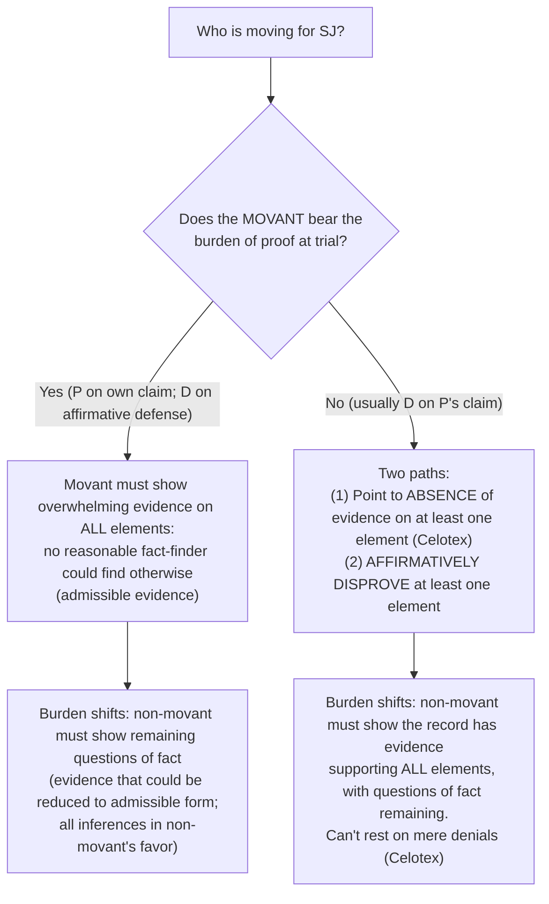

# Summary Judgment Analysis

## Steps
1. Identify **which party is moving**.
2. Identify **which party has the burden of proof at trial**.
3. **If the movant has the burden at trial** (P on its own claim, or D on an [[Affirmative Defenses|affirmative defense]]):
   - It's not enough to point to gaps in the other side's evidence. The movant must show proof on **all** elements: "Any reasonable fact-finder would have to find for me on each element."
   - This seems to require evidence that would be **admissible at trial**.
   - If shown, the burden shifts to the non-movant to show questions of fact remain. It seems the non-movant can use evidence that **could be reduced to admissible form** at trial, and all inferences are drawn in its favor.
4. **If the movant does NOT have the burden at trial**, it can either:
   - show by **affirmative evidence** that an essential element of the non-movant's case is missing; **or**
   - show the record is **devoid of evidence** on an element. There doesn't need to be a total absence, just so little that no fact-finder could find the element met. **This is usually easier.**
   - Then the non-movant must show the record has evidence supporting **all** elements and that questions of fact remain. It **cannot rest on mere denials** ([[Celotex Corp. v. Catrett]]).

See [[Summary Judgment]] · [[Burden of Production and Persuasion]] · [[Genuine Dispute of Material Fact]]
