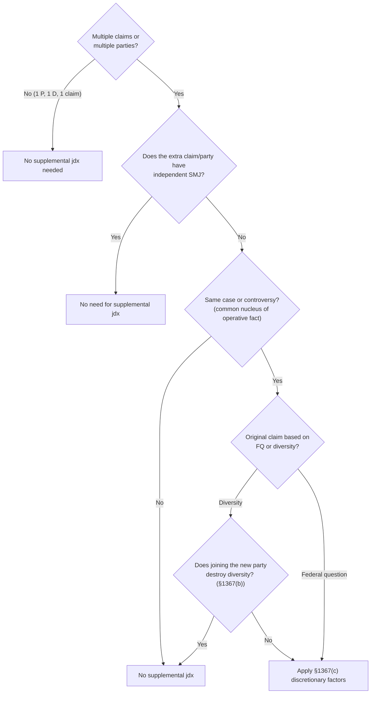

# Supplemental Jurisdiction Analysis

## Steps
1. Are there **multiple claims or parties**? If 1 P, 1 D, 1 claim, there's nothing to analyze.
2. Does the extra claim or party have **independent SMJ** ([[Diversity Jurisdiction]] or [[Federal Question Jurisdiction]])? If so, stop.
3. Is it part of the **same case or controversy** ([[Common Nucleus of Operative Fact]])? If not, there's no supplemental jurisdiction.
4. Is the original claim based on **FQ or diversity**?
5. If **diversity**: will joining the new party destroy diversity (§1367(b))?
6. Apply the **§1367(c)** factors: novel or complex state issue · state claim predominates · original claims dismissed · exceptional circumstances.

See [[Supplemental Jurisdiction]] · [[28 USC 1367 - Supplemental Jurisdiction]]
